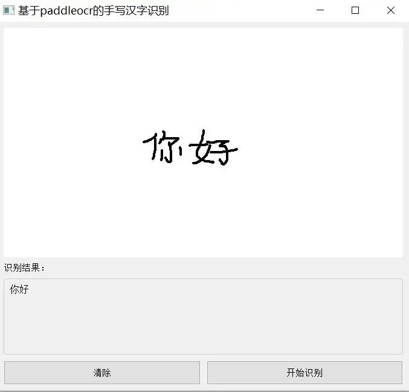

# A simple handwritten Chinese character recognition system based on PaddleOCR+pyqt5

I. Project Overview

This project is a handwritten Chinese character recognition system based on PyQt5 and PaddleOCR. Users can write Chinese characters with the mouse on the interface, and after clicking the "Start Recognition" button, the system will automatically recognize the handwritten content and display the recognition results below.

II. Environmental Installation

1. Install Python

It is recommended to use Python 3.8 and above.

2. Install Dependency Libraries

Please execute the following commands in sequence:

# Install PyQt5

pip install PyQt5

# Install PaddlePaddle (choose the appropriate version according to your graphics card, here take CUDA 11.8 as an example)

pip install paddlepaddle-gpu==3.0.0 -i https://www.paddlepaddle.org.cn/packages/stable/cu118/

# Install PaddleOCR

pip install paddleocr -i https://pypi.tuna.tsinghua.edu.cn/simple

# Additionally, install OpenCV and NumPy.

pip install opencv-python numpy

Note: If NVIDIA graphics cards are not available, replace paddlepaddle-gpu with paddle.

III. Project Structure

First, we obtain the project code from gitee.com/FIRC/fircfiles/blob/master/handwritting.md and then unzip the files into a directory of our own choosing. Afterwards, we can open the directory to see the following project structure:

├── main.py  # Main program, PyQt5 interface and recognition logic

├── PaddleocrManager.py  # OCR recognition management class, encapsulates calls to PaddleOCR

├── Instructions.txt  # Short usage instructions

├── reademe.MD  # This document provides a detailed explanation of the project.

main.py: Implements handwritten interface, buttons, results display, and integration with OCR.

PaddleocrManager.py: Encapsulates the initialization and recognition methods of PaddleOCR.

IV. Operation Method

After installing all dependencies, run the following command:

python main.py

Interface Description:

Type Chinese characters in the white area with a mouse.

Click the "Clear" button to clear the canvas and results.

Click the "Start Recognition" button, and the recognition results will be displayed in the area below.

V. Main Code Process Flow Explanation

Interface initialization

Create a main window that includes a handwriting area, recognition result display area, and button area.

All controls are adaptive to window size.

Handwritten input

Users draw on the DrawingArea control with a mouse, and the content is displayed in real-time.

Identification process

When the "Start Recognition" button is clicked:

Get the current canvas content and convert it to an OpenCV format image.

Invoke the PaddleOCRManager.start() method for recognition.

The recognition results are displayed in the text box below.

Clear function

Click the "Clear" button to clear both the canvas and the result area simultaneously.

VI. Common Issues

If the first run is slow, PaddleOCR will automatically download the model. Please wait patiently.

If the recognition effect is poor, you can try to write more standard or adjust the thickness of the brush.

If you encounter dependency installation issues, please make sure that the version of Python and pip is correct.

## Payment

Here is a pay link on Stripe ( https://buy.stripe.com/3cs8yP7sY87d0vu9AB ). Please contact me lonlonago@foxmail.com after funding $89, and I will send you a complete data files , thank you!

